# Diagrama Entidad–Relación — db_test_7b

DER extraído del DDL `db_test_7b1211.sql`. Cardinalidad determinada por nulabilidad y unicidad de cada FK; cada línea corresponde a una constraint. Se verificaron 34 FKs. Aunque `tb_people.user_ID` es unique, admite NULL; por eso la relación con `tb_users` se representa opcional en ambos extremos, como permite el DDL.

```mermaid
erDiagram
    tb_buyer_orders {
        int_unsigned ID PK
        int seller_ID FK
        decimal_12_2 subtotal
        decimal_12_2 shipping_cost
        enum_Pending_Accepted_Preparing_Sent_Delivered_Canceled_Returned fulfillment_status
        bit_1 status
        datetime creation_date
        datetime last_update
    }
    tb_carts {
        int_unsigned ID PK
        int user_ID FK, UK
        bit_1 status
        datetime creation_date
        datetime last_update
    }
    tb_logs {
        int ID PK
        varchar_80 table_name
        enum_Create_Read_Update_Delete table_operation
        varchar_80 db_user
        datetime operation_date
        text table_description
        bit_1 operation_status
    }
    tb_order_cancellations {
        int_unsigned ID PK
        int_unsigned order_ID FK
        text reason
        bit_1 status
        datetime creation_date
        timestamp created_at
        varchar_100 created_by
        timestamp last_update
    }
    tb_payment_methods {
        int_unsigned ID PK
        int user_ID FK
        varchar_50 name
        varchar_255 description
        bit_1 status
        datetime creation_date
        timestamp created_at
        varchar_100 created_by
        timestamp last_update
    }
    tb_payment_transaction {
        int_unsigned ID PK
        int_unsigned payment_ID FK
        varchar_255 transaction_ref
        decimal_12_2 amount
        bit_1 status
        datetime creation_date
        timestamp created_at
        varchar_100 created_by
        timestamp last_update
    }
    tb_payments {
        int_unsigned ID PK
        int_unsigned order_ID FK
        bigint_unsigned user_payment_method_ID FK
        decimal_12_2 amount
        bit_1 status
        datetime creation_date
        timestamp created_at
        varchar_100 created_by
        timestamp last_update
    }
    tb_people {
        bigint_unsigned person_ID PK
        int user_ID FK, UK
        varchar_20 courtesy_title
        varchar_150 given_names
        varchar_150 family_names
        date birth_date
        enum_Hombre_Mujer_Prefiero_no_decirlo gender
        char_2 country_code
        varchar_25 phone
        bit_1 status
        datetime creation_date
        datetime last_update
    }
    tb_products {
        int_unsigned ID PK
        varchar_50 SKU UK
        varchar_250 name
        text description
        decimal_10_2 current_price
        int_unsigned current_stock
        bit_1 status
        datetime creation_date
        datetime last_update
    }
    tb_refunds {
        int_unsigned ID PK
        int_unsigned order_ID FK
        text reason
        decimal_12_2 amount
        bit_1 status
        datetime creation_date
        timestamp created_at
        varchar_100 created_by
        timestamp last_update
    }
    tb_returns {
        int_unsigned ID PK
        int_unsigned order_ID FK
        text reason
        bit_1 status
        datetime creation_date
        timestamp created_at
        varchar_100 created_by
        timestamp last_update
    }
    tb_shipments {
        int_unsigned ID PK
        int_unsigned order_ID FK
        bigint_unsigned address_ID FK
        varchar_50 carrier
        varchar_100 tracking_number
        bit_1 status
        datetime creation_date
        timestamp created_at
        varchar_100 created_by
        timestamp last_update
    }
    tb_user_addresses {
        bigint_unsigned ID PK
        int user_ID FK
        varchar_100 address_label
        varchar_150 recipient_name
        varchar_25 recipient_phone
        varchar_500 delivery_instructions
        decimal_10_7 latitude
        decimal_10_7 longitude
        tinyint_1 is_default
        bit_1 status
        datetime creation_date
        datetime last_update
    }
    tb_users {
        int ID PK
        varchar_100 email UK
        varchar_50 nick UK
        varchar_255 password
        datetime creation_date
        datetime last_update
        datetime last_login
        bit_1 status
    }
    tbc_categories {
        int_unsigned ID PK
        varchar_120 name UK
        text description
        int_unsigned sup_id_category FK
        bit_1 status
        datetime creation_date
        datetime last_update
    }
    tbc_payment_methods_types {
        int_unsigned ID PK
        varchar_30 code
        text description
        bit_1 status
        datetime creation_date
        datetime last_update
    }
    tbd_address_components {
        bigint_unsigned ID PK, UK
        bigint_unsigned address_ID FK, UK
        varchar_255 value
        varchar_50 component_type
        bit_1 status
        bigint_unsigned address_sup_ID FK
        datetime creation_date
        datetime last_update
    }
    tbd_cancellation_items {
        int_unsigned cancellation_ID PK, FK
        int_unsigned product_ID PK, FK
        int_unsigned quantity
        datetime creation_date
        timestamp created_at
        varchar_100 created_by
        timestamp last_update
    }
    tbd_carts_items {
        int_unsigned cart_ID PK, FK
        int provider_ID PK, FK
        int_unsigned product_ID PK, FK
        int_unsigned quantity
        datetime creation_date
    }
    tbd_order_items {
        int_unsigned ID PK
        int_unsigned seller_order_ID FK
        int_unsigned product_ID FK
        int provider_ID FK
        varchar_255 product_name
        int_unsigned quantity
        decimal_12_2 unit_price
        decimal_12_2 subtotal
        datetime creation_date
    }
    tbd_products_categorias {
        int_unsigned product_ID PK, FK
        int_unsigned category_ID PK, FK
        bit_1 status
        datetime creation_date
        datetime last_update
    }
    tbd_products_users_providers {
        int user_ID PK, FK
        int_unsigned product_ID PK, FK
        enum_Owner_Reseller_Distributor type_ownership
        bit_1 status
        datetime avalaible_date
        datetime creation_date
        datetime last_update
    }
    tbd_return_items {
        int_unsigned return_ID PK, FK
        int_unsigned product_ID PK, FK
        int_unsigned quantity
        datetime creation_date
        timestamp created_at
        varchar_100 created_by
        timestamp last_update
    }
    tbd_user_payment_methods {
        bigint_unsigned ID PK
        int user_ID FK
        int_unsigned payment_method_type_ID FK
        varchar_60 provider UK
        varchar_255 provider_method_ref UK
        varchar_100 label
        char_4 last_four
        tinyint_1 is_default
        bit_1 status
        datetime creation_date
        datetime last_update
    }
    tbd_users_wishlist_products {
        int user_ID PK, FK
        int_unsigned product_ID PK, FK
        bit_1 status
        datetime creation_date
        datetime last_update
    }
    tb_users ||--o{ tb_buyer_orders : "tb_buyer_orders_ibfk_1"
    tb_users ||--o| tb_carts : "tb_carts_ibfk_1"
    tb_buyer_orders ||--o{ tb_order_cancellations : "fk_order_cancellations_order"
    tb_users ||--o{ tb_payment_methods : "fk_payment_methods_user"
    tb_payments ||--o{ tb_payment_transaction : "fk_payment_transaction_payment"
    tb_buyer_orders ||--o{ tb_payments : "fk_payments_order"
    tbd_user_payment_methods o|--o{ tb_payments : "fk_payments_user_payment_method"
    tb_users o|--o| tb_people : "fk_people_users"
    tb_buyer_orders ||--o{ tb_refunds : "fk_refunds_order"
    tb_buyer_orders ||--o{ tb_returns : "fk_returns_order"
    tb_user_addresses o|--o{ tb_shipments : "fk_shipments_address"
    tb_buyer_orders ||--o{ tb_shipments : "fk_shipments_order"
    tb_users ||--o{ tb_user_addresses : "fk_addresses_users"
    tbc_categories o|--o{ tbc_categories : "fk_superior_category"
    tb_user_addresses ||--o{ tbd_address_components : "fk_component_address"
    tbd_address_components ||--o{ tbd_address_components : "fk_component_parent"
    tb_order_cancellations ||--o{ tbd_cancellation_items : "fk_cancellation_items_cancellation"
    tb_products ||--o{ tbd_cancellation_items : "fk_cancellation_items_product"
    tb_carts ||--o{ tbd_carts_items : "tbd_carts_items_ibfk_1"
    tbd_products_users_providers ||--o{ tbd_carts_items : "tbd_carts_items_ibfk_2"
    tbd_products_users_providers ||--o{ tbd_carts_items : "tbd_carts_items_ibfk_3"
    tb_buyer_orders ||--o{ tbd_order_items : "tbd_order_items_ibfk_1"
    tbd_products_users_providers ||--o{ tbd_order_items : "tbd_order_items_ibfk_2"
    tbd_products_users_providers ||--o{ tbd_order_items : "tbd_order_items_ibfk_3"
    tbc_categories ||--o{ tbd_products_categorias : "fk_category1"
    tb_products ||--o{ tbd_products_categorias : "fk_product1"
    tb_products ||--o{ tbd_products_users_providers : "fk_products2"
    tb_users ||--o{ tbd_products_users_providers : "fk_user1"
    tb_products ||--o{ tbd_return_items : "fk_return_items_product"
    tb_returns ||--o{ tbd_return_items : "fk_return_items_return"
    tbc_payment_methods_types ||--o{ tbd_user_payment_methods : "fk_user_payment_type"
    tb_users ||--o{ tbd_user_payment_methods : "fk_user_payment_user"
    tb_products ||--o{ tbd_users_wishlist_products : "fk_products3"
    tb_users ||--o{ tbd_users_wishlist_products : "fk_user2"
```

## Módulos

- **Usuarios y Seguridad:** `tb_users`, `tb_people`, `tb_user_addresses`, `tbd_address_components`, `tbd_user_payment_methods`, `tbd_users_wishlist_products`
- **Catálogo y Productos:** `tb_products`, `tbc_categories`, `tbd_products_categorias`, `tbd_products_users_providers`, `tbc_payment_methods_types`
- **Órdenes y Pagos:** `tb_buyer_orders`, `tb_carts`, `tb_payment_methods`, `tb_payment_transaction`, `tb_payments`, `tbd_carts_items`, `tbd_order_items`
- **Envíos, Devoluciones y Cancelaciones:** `tb_shipments`, `tb_returns`, `tb_refunds`, `tb_order_cancellations`, `tbd_return_items`, `tbd_cancellation_items`
- **Auditoría y Bitácora:** `tb_logs`
